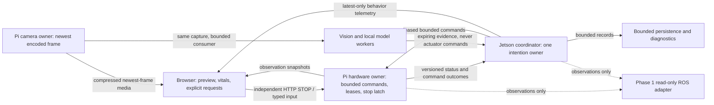

# Crab systems direction: a phased ROS 2 backbone

Decision record, 2026-10-26. **ROS 2 is the intended long-term robotics backbone**
for typed observations, diagnostics/replay, perception and component lifecycle.
The owner explicitly prefers its flexibility. Migrate in reversible phases with
the Pi remaining the sole hardware owner. The first runtime phase is a read-only
adapter; its purpose is to establish the contracts and validate the platform
before replacing components. This document is a local design, not an installation
or a working ROS integration. The immediate dashboard repair works without ROS.

## What is known, and what is not

Owner evidence identifies a Pi 4B, Robot HAT v4 / robot-hat2.5.3, OV5647, and Jetson
Orin Nano Super 8GB. Existing camera tests distinguish 640x480q80 from clearer but
slower960x720q90. The installed OS, architecture, JetPack/L4T, CUDA/TensorRT and
ROS-compatible Python versions have not been inventoried in this task. Bookworm
is a repository target, not a verified inventory result here. No device was
accessed, model loaded, driver changed or hardware benchmark performed.

## Responsibilities and interfaces

The diagram shows target logical ownership, not a claim that each box is already
a separate process. In particular, bounded persistence ownership and the ROS
adapter are proposed work; the current persistence path is synchronous.

Pi remains the only actuator writer. An inference result, dashboard observation,
ROS message, lifecycle activation or recording replay cannot mint command
authority. Keep boot/session/control epoch, one-use leases, expiry, STOP priority,
explicit fresh Resume and no retries after uncertain completion. A successful
vendor boundary is not measured displacement; no odometry/joint feedback exists.

Keep media bytes outside state JSON. The camera owner performs one capture;
consumers retain newest work with bounded buffers and drops, rather than request
new captures. Preserve the original encoded/capture timestamp and its domain;
current encoded-output arrival is not exposure time. Camera clarity also depends
on optics, scene and exposure, not only resolution or transport implementation.

One observation contract should eventually be versioned explicitly: producer,
source/provenance, boot/session, sequence, original acquisition timestamp/domain,
producer-monotonic sample age where available, receipt time, age/offset interval,
availability, use, reason and verification level. Unknown timing is not zero age.
Displayable diagnostics can survive calibration failure while safety freshness
and Resume remain false. Pi–Jetson and browser–Pi clock evidence are separate.
Local monotonic deadlines govern watchdogs; ROS/system wall time is not a
replacement. [ROS clock design](https://design.ros2.org/articles/clock_and_time.html)
describes distinct steady/system/ROS clocks and discontinuous simulated time.

Transport liveness, coordinator progress, inference progress and hardware health
must be distinct. Today a healthy socket reader can send pings while coordinator
SQLite/log I/O is blocked. First expose monotonic progress ages; any later command
progress watchdog needs its own measured deadline and explicit stop/recovery
contract. Do not silently redefine existing heartbeat or lease semantics.

## Three options

| Direction | Benefit | Cost / risk | Choice |
| --- | --- | --- | --- |
| Retain current lightweight stack indefinitely | Existing drivers, browser and tested authority boundaries | Continues custom contracts, diagnostics and integration work | Near-term operating baseline, not the intended final architecture |
| Migrate incrementally through a read-only ROS 2 bridge | Standard tools and typed interfaces while preserving current behavior | A temporary dual stack and adapter maintenance | Selected route to the long-term backbone |
| Replace the stack in one broad port | Uniform interfaces sooner | Reopens every ownership, timing, startup and safety boundary at once | Reject as the first implementation step |

ROS is not automatic low latency or physical safety. Composition can exchange
process isolation for lower overhead; it does not establish cross-host or Python
zero-copy. Blocking, allocation and scheduler jitter still matter. See official
[composition](https://raw.githubusercontent.com/ros2/ros2_documentation/rolling/source/ROS-Framework/nodes/About-Composition.rst)
and [real-time design guidance](https://raw.githubusercontent.com/ros2/ros2_documentation/jazzy/source/Tutorials/Demos/Real-Time-Programming.rst).

## Current release/platform constraints

Checked against official documentation on 2026-10-26:

| Distribution | Overall support | Relevant arm64 binary target |
| --- | --- | --- |
| Lyrical Luth | May 2026–May 2031 | Ubuntu 26.04 Tier 1 |
| Jazzy Jalisco | Through May 2029 | Ubuntu 24.04 Tier 1 |
| Humble Hawksbill | Through May 2027 | Ubuntu 22.04 Tier 1 |

Lyrical lists Ubuntu 24.04 and Debian 13 as Tier 3/source targets; its Ubuntu 24.04
support ends June 2029. Jazzy lists Debian 12 Bookworm as Tier 3/source, rather than
the Ubuntu binary target. Match the actual OS and interpreter, not the board
name. The release list and platform tables are authoritative:
[releases](https://raw.githubusercontent.com/ros2/ros2_documentation/rolling/source/Releases.rst),
[Lyrical platforms](https://raw.githubusercontent.com/ros2/ros2_documentation/rolling/source/Releases/lyrical/supported-platforms.rst),
[REP2000 for Jazzy/Humble](https://reps.openrobotics.org/rep-2000/).

NVIDIA lists Orin support and Ubuntu 24.04 in JetPack 7.2; this does not identify the
owner's installed version or establish Isaac ROS compatibility. An installed
Ubuntu 24.04 Jetson would make Jazzy a plausible binary-supported experiment;
Ubuntu 22.04 would imply a different choice and shorter Humble support runway.
No OS/JetPack upgrade is proposed to accommodate an adapter.
[NVIDIA release/platform table](https://developer.nvidia.com/embedded/jetpack/downloads/archive-7.2).

The ROS Pi guide discusses Ubuntu or an Ubuntu container on64-bit Pi OS, but that
is not proof that this HAT/CSI/Picamera2 access works inside a container. Keep Pi
vendor drivers outside the first adapter experiment. Python binary compatibility
also matters. [Pi guidance](https://raw.githubusercontent.com/ros2/ros2_documentation/rolling/source/Get-Started/Installation/Installing-on-Raspberry-Pi.rst),
[Python environments](https://raw.githubusercontent.com/ros2/ros2_documentation/jazzy/source/How-To-Guides/Using-Python-Packages.rst).

## Typed interface design

These are proposed contracts for a future `crab_interfaces` package, not generated
`.msg` files or executable nodes in this patch. Use standard messages where their
semantics fit and custom types for safety-relevant context. Pin field definitions
and versioning before generating language bindings.

| Interface | Proposed representation | Required semantics |
| --- | --- | --- |
| Observation identity / timing | `ObservationContext`: schema version, producer/source IDs, boot ID, session ID, uint64 sequence, acquisition time/domain, acquisition-valid flag, producer-local sample age and validity, receipt time, offset lower/upper bounds and calibration validity | Original acquisition and local receipt remain distinct. Invalid timing has an explicit flag; never compare host monotonic epochs or treat a zero timestamp as fresh. |
| Sensor health | `InputHealth`: context, availability enum, use enum, verification enum, reason, max-age, age lower/upper bounds and validity | Separate disabled, unsupported, warming, available, stale, unknown and error; separate current use from hardware verification. Missing sonar echo is not a zero range. |
| Range and battery | `sensor_msgs/Range` / `sensor_msgs/BatteryState`, associated by observation identity with health | Units/range limits explicit; unknown fields use the standard representation plus health validity. No fabricated percentage, current or state-of-charge estimator. |
| Camera | `sensor_msgs/CompressedImage` with observation/timing metadata and calibration only when measured | Reuse existing encoded JPEG; no additional capture/encoder. Encoded-output time must not claim exposure time. CameraInfo has no guessed calibration. |
| Robot / companion health | `RobotState` and `CoordinatorState`, plus `diagnostic_msgs/DiagnosticArray` for tools | Boot/session/epoch, stop reason, motion-enabled flag, progress ages, last result and component failures are typed. Diagnostics are evidence, not command authority. |
| Intent and result | `IntentState` / `ActionOutcome`: ID, parent ID, source, requested/accepted/queued/dispatched/completed/cancelled/unknown, reason, timestamps and result provenance | Distinguish vendor completion from measured displacement, process success from audibility, generated narrative from perception. Uncertain results are never automatically retried. |
| Perception | `vision_msgs` detections where appropriate plus observation identity, model/version, input sequence, inference duration and expiration | Detection is evidence for the one coordinator, never an actuator command or person identity. Reject stale outputs even if recently published. |

Future command types need their own reviewed envelope: request ID, controller
session, target boot ID, control epoch, fresh one-use authorization/lease and
explicit expiry. The initial interface package must not expose a command path.
Long-running actions need cancellation and explicit uncertain outcomes; a ROS
action server or reliable service is not itself the authorization mechanism.

`rosbag2` is useful for selected observation, health and outcome topics. Recording
is opt-in, bounded by storage/retention and excludes raw camera, microphone and
private typed text by default. Replay runs in an isolated, explicit simulation
graph with a new replay provenance/session and no hardware route. Record original
timestamps and reception timing separately; enabling ROS simulated time must not
alter the Pi's monotonic stop/lease deadlines. Replayed data cannot re-arm motion.
Message definitions must be checked against the pinned distribution:
[Range](https://raw.githubusercontent.com/ros2/common_interfaces/rolling/sensor_msgs/msg/Range.msg),
[BatteryState](https://raw.githubusercontent.com/ros2/common_interfaces/rolling/sensor_msgs/msg/BatteryState.msg),
[CompressedImage](https://raw.githubusercontent.com/ros2/common_interfaces/rolling/sensor_msgs/msg/CompressedImage.msg),
[DiagnosticArray](https://github.com/ros2/common_interfaces/blob/rolling/diagnostic_msgs/msg/DiagnosticArray.msg).
The recording/replay mechanism is documented in
[rosbag2](https://raw.githubusercontent.com/ros2/rosbag2/rolling/README.md); the
isolation, privacy and authority restrictions above are Crab design requirements.

## First adapter and dashboard gateway

Start on a development host or Jetson. Consume validated read-only HTTP/state
snapshots; do not acquire another companion control WebSocket. Publish explicit
unknown/stale/error/provenance information. Optional `CompressedImage` uses the
existing JPEG without another capture or encoding pipeline. No actuator topic,
command service, automatic recording, lifecycle-to-arm mapping or config writer.

Proposed QoS follows freshness needs, rather than defaults:

| Channel | Initial proposal | Required application checks |
| --- | --- | --- |
| Camera / fast observations | Best effort, Keep Last1, volatile, finite lifespan | Original capture age, sequence/boot and bounded decoder |
| Future command/result interface | Reliable, volatile, bounded | Existing authority, expiry, cancellation and uncertain-result rules |
| Static descriptions | Transient local only when replay is intentional | Never use this durability for actuator requests |

QoS incompatibility can prevent delivery. Middleware lifespan concerns publication
to reception: republishing an old frame does not make its original capture fresh.
Reliable delivery is not safe replay or proof of execution.
[Official QoS policies](https://raw.githubusercontent.com/ros2/ros2_documentation/rolling/source/ROS-Framework/interfaces/topics/About-Quality-of-Service-Settings.rst).

Pin one tested distro, message contract and middleware for a distributed graph;
[ROS does not guarantee cross-distro interoperability](https://raw.githubusercontent.com/ros2/ros2_documentation/rolling/source/Releases.rst). Start discovery on
localhost; network discovery/peers are a later explicit deployment decision.
Security needs deliberate identities, permissions and enforcing configuration;
a domain ID is not authorization. These are design constraints, not settings
changed by this task. [Discovery](https://raw.githubusercontent.com/ros2/ros2_documentation/jazzy/source/Tutorials/Advanced/Improved-Dynamic-Discovery.rst),
[security](https://raw.githubusercontent.com/ros2/ros2_documentation/jazzy/source/Concepts/Intermediate/About-Security.rst).

Managed lifecycle nodes can organize configure/activate/deactivate/cleanup, but
application callbacks and a supervisor implement the actual behavior. “Active”
must never mean actuators enabled. DDS deadline/liveliness signals supplement,
not replace, local monotonic authority/watchdog checks.
[Lifecycle design](https://design.ros2.org/articles/node_lifecycle.html).

## Staging and rollback gates

| Phase | Deliverable | Exit gate / rollback |
| --- | --- | --- |
| 0 — reliable baseline | This local repair, observed versus trusted state, bounded metric collection, independent readiness stages; then separate progress/lifecycle fixes in the backlog | Current browser and safety regressions pass with explicit known failures recorded. Roll back the local patch without touching saved config or calibration. |
| 1 — platform and contracts | Owner-controlled read-only inventory: OS/bitness, Python, JetPack/L4T/CUDA/TensorRT and Picamera2/libcamera/HAT. Select one distro/RMW. Generate `crab_interfaces`, synthetic publishers/subscribers and contract fixtures | Build on the selected compatible platform; test invalid/missing timing, boot/sequence changes and health enums. No guessed distro, driver or OS upgrade. No control interface. |
| 2 — observation backbone | Disabled-by-default Jetson/development-host adapter, typed sensors/health/intent, diagnostics; optional bounded recording and isolated replay | Start/stop/crash/stall adapter without changing current behavior or acquiring a control owner. Compare CPU/RSS/shared RAM, bytes, drops and p95/p99 age under idle and model load. Test incompatible QoS. Rollback removes only adapter launch. |
| 3 — dashboard gateway | A bounded gateway converts typed observations into the existing browser view contract/SSE; camera media remains separate and newest-only | Run existing native-browser acceptance against both gateways, including null/stale/skew/reboot and STOP/Resume. Switch observations by explicit launch profile; old HTTP/SSE path is the rollback. STOP keeps its independent Pi path during migration. |
| 4 — perception components | Detectors/vision workers subscribe to the same captured image and publish expiring typed evidence; future speech/mind integration follows the same lifecycle/health pattern | Model timeout/crash/slow subscriber cannot stall status, coordinator or STOP. Measure shared 8GB RAM headroom including OS/models; no second capture/encoder. Disable the ROS component to restore the existing worker. |
| 5 — coordinator and lifecycle | One coordinator consumes typed evidence and publishes intent/outcomes; supervisor handles configure/activate/deactivate/fault recovery. Persistence stays a separate bounded owner | Prove one intention owner, preserved memory/config, progress watchdogs, no automatic re-arm or replay. Shadow mode emits no commands; compare deterministic scenarios before selecting the new owner. Rollback stops the new owner before restoring the old one. |
| 6 — reviewed command gateway | If command transport moves to ROS, a Pi-side gateway validates the existing boot/session/epoch/expiry/lease protocol and calls the sole vendor-motion owner | Separate safety design and fault-injection matrix before any hardware command. Cover STOP priority, disconnect, stale lease, cancellation, duplicate/replayed requests, uncertain completion and explicit fresh Resume. One transport is authoritative at a time; the legacy path is not a concurrent writer. Rollback leaves STOP latched and requires deliberate fresh authorization. |

Each runtime phase is future work requiring its own review and deployment
authorization. ROS is the destination; measurements determine the sequencing,
resource budget and whether an individual component is ready to move. No ROS
runtime, interface package or hardware migration was executed in this iteration.

## Reuse versus replacement

Keep the bounded vendor adapter, HAT amplifier cleanup, capture ownership,
provenance/clock policy and monotonic safety rules. Keep the browser's visual
hierarchy, local preview scheduling and honest unknown/error states. They become
acceptance criteria and reusable implementation, rather than being discarded for
ROS. Keep saved identity/memory/calibration formats until an explicit migration.

Replace ad-hoc observation dictionaries with versioned typed contracts, gradually
replace custom telemetry polling/aggregation with the ROS observation gateway,
and move worker supervision into managed component lifecycles. The current
WebSocket authority remains until the final reviewed command phase. ROS messages
do not replace the lease/epoch checks, and lifecycle activation never enables
actuators. Component boundaries can move without rewriting working vendor timing.
