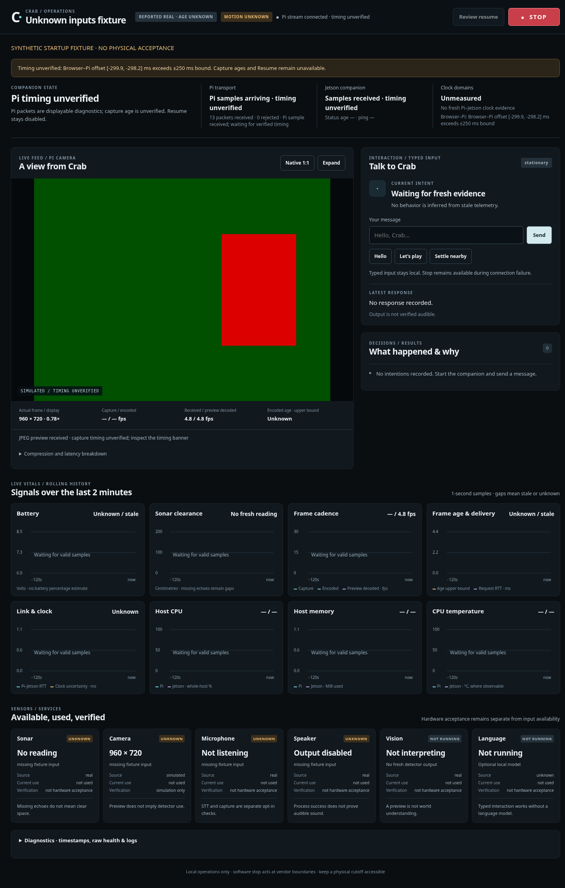
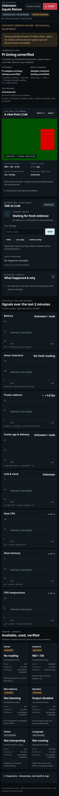
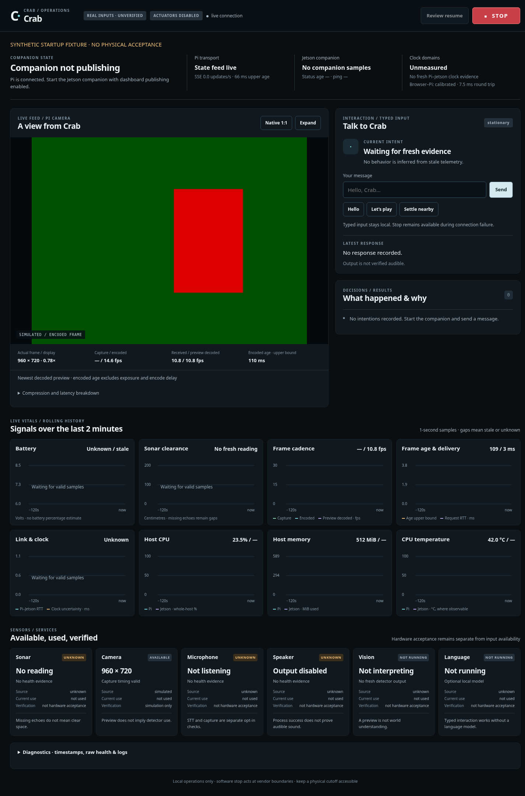

# Dashboard reliability repair — 2026-10-26

The dashboard's silent startup failure and the live Resume-ordering race are
reproduced and repaired locally. Final full smoke passes 347 tests and all stages.
ROS 2 is the intended long-term backbone, with a staged migration design and
prioritized backlog. The evidence below comes from development-host tests; it
does not establish acceptance on either device.

Base: `88df7b3f8792524e7e025c610e6854064d3118fd`.
Branch: `fix/dashboard-startup-diagnostics`.

## Cause and evidence

On the base revision, the browser's clock probe fetched the entire diagnostic
snapshot. A rejected calibration silently discarded every SSE state before
assigning `latestState`. Rendering and preview FPS then depended on a state that
could never arrive. HTTP200, active native SSE and decoded JPEGs could coexist
with SOURCE UNKNOWN, “Waiting for companion” and blank preview rates, without a
JavaScript error. New host metrics also collected synchronously inside snapshot
and publisher paths, adding avoidable work to timing-sensitive observations.

An actual loopback Uvicorn server and Chromium/native EventSource reproduced the
same UI mechanism: injected +300ms browser skew, five received state events,
decoded960x720, no trusted state/anchor, initial labels and blank FPS. Null/missing
physical-mode metrics by themselves rendered correctly. The injected skew is a
test fixture, **not a measurement of the owner's clocks**. The specific predicate
that failed on the physical deployment remains unknown; hardware metric latency
was not measured. [Before-repair evidence](../evidence/dashboard-before-repair.json).

## Changes

- `/sim/clock` returns only Pi wall time and boot ID without collecting metrics,
  camera stats, telemetry or control authority. The browser reports HTTP, malformed
  reply, RTT, offset and clock-step rejection reasons separately from SSE health.
- The UI retains a display-only observation when timing is untrusted, with unknown
  capture ages. Preview receipt/decode rates remain locally measurable. Trusted
  state/freshness and Resume stay blocked; the clock bounds are unchanged.
- Terminal EventSource failures schedule one reconnect; hidden pages cancel it.
  Pi boot changes reset preview sequence/decode state even without calibration,
  avoiding a preview frozen behind an old boot's sequence number.
- Rendering errors remain visible, keep STOP independent, disable Resume and retry
  at the existing bounded render cadence. Unavailable metrics remain gaps, not
  zeros. Missing companion publication is distinguished from missing Pi state.
- One optional daemon sampler per process collects host vitals outside request
  and publisher paths. Snapshot reads are cached/nonblocking; sample age includes
  collection time, failures stay unknown, and late results cannot restore health
  after close. Startup/shutdown and the caller's cleanup budget are covered.
- Readiness reports independent health, protocol advertisement, status, Pi audio
  diagnostics and local audio results with stage durations. One failed stage no
  longer hides the others. It acquires no control WebSocket or playback/mic input.
- Epoch-scoped Resume records the original explicit event epoch only after a
  fresh same-boot/unlatched acknowledgement. It supports both result/status
  arrival orders, rejects contradictory/newer authority and lower epoch replay,
  and never refreshes status/sensor age from command receipt. Invalid/uncertain
  Resume acknowledgement reasserts STOP. No automatic Resume or command retry.

No changes to canonical clock thresholds, transport command lease/session/epoch
checks, motion, sonar, amplifier behavior, device configuration or smoke-test
sequencing/timeouts. Source comparison for those protected files is clean. The
coordinator change is limited to acknowledgement ordering and fail-closed error
handling. Audio, microphone, homing and movement opt-in defaults remain in force.
This patch adds no capture consumer, encoder switch, framework, ROS runtime or
model service.

## Resume race: runtime defect versus test sequencing

The independent reviewer reproduced the fault with virtual clocks and a completed
Future, without a server or smoke harness: status epoch3 → explicit event epoch4
→ successful epoch4 Resume result → next unlatched epoch4 status relatches the
coordinator. `_poll` previously fenced only `observed_at`, leaving `_status` at
epoch3. This is a runtime ordering defect. The actual full smoke now passes with
the exact same greeting/STOP/Resume sequence and timeout.

The response's `RobotStatus` does not carry a control epoch. The valid one-use
lease ties success to the **original explicit event epoch**, so acknowledgement
must not borrow a newer epoch from transport health. The result must match the
dispatch/current boot, report unlatched state, and have fresh capture timing after
the dispatch-time status fence. If a newer status overtook the result, it must
corroborate the same epoch and unlatched state. The age of the sampled status is
not refreshed. A genuinely newer STOP still cancels an older Resume; an event
created before a newer STOP remains outdated and requires a new explicit request.

Sixteen deterministic regressions cover both arrival orders, STOP before/after
result polling, lower-epoch replay, reboot, status expiry, stale/replayed/future or
missing acknowledgement timing, wrong boot, malformed latch and failed results.
The independent review found an extra STOP after a cancelled RPC error whose
worker had already confirmed cleanup STOP. A red/green held-RPC regression closes
that case: it remains cancelled, records the RPC error and issues no further
loss/STOP transition. Unconfirmed cleanup still follows the fail-closed path.
The existing held-RPC fake now supplies wire-realistic result status; assertions
were retained. Independent safety/concurrency review is recorded with the final
verification evidence.

## Verification

All commands below are development-host checks with explicit simulation/fakes;
none establishes physical acceptance.

| Check | Result | Evidence |
| --- | --- | --- |
| Four focused regression suites | PASS, 54 tests | `/tmp/crab-dashboard-focused-final.log` |
| Resume/coordinator/transport affected suites | PASS, 89 tests | `/tmp/crab-resume-affected-final.log` |
| Earlier `bash test_sim.sh --quick`, before the Resume repair | PASS, 331 tests plus off-body, 9 scenarios and HTTP/virtual-body/synthetic-camera checks | `/tmp/crab-dashboard-local-quick-complete.log` |
| Earlier full smoke, before the Resume repair | FAIL after 331 tests and scenario/HTTP stages at the reproduced live Resume-ordering defect | `/tmp/crab-dashboard-local-completion-full.log` |
| `bash test_sim.sh` on repaired final source | PASS, 347 tests, off-body, 9 scenarios, HTTP/virtual-body/synthetic-camera and live greeting/priority STOP/explicit Resume | `/tmp/crab-resume-full-final.log` |
| Native startup/recovery browser | PASS: real HTTP/SSE, null/slow metrics, injected skew, actual300ms network delay, reconnect, fake Pi reboot with old sequence fence, Pi vitals without companion,320/768/1024/1440 widths | [JSON](../evidence/dashboard-startup-native.json) |
| Mission-control browser fixtures | PASS: real/sim, disabled/error/stale,390mobile, native/expanded camera, STOP during decode, deliberate Resume, peak one preview request | [JSON](../evidence/dashboard-mission-fixtures.json) |
| Existing native live-feed browser | PASS: +30ms clock fixture, stale capture retained, reconnect, no horizontal overflow, peak one camera request | [JSON](../evidence/dashboard-live-native.json) |
| Python compileall, Node syntax, launcher/test shell syntax, `git diff --check` | PASS | Local completion checks |
| Hardware/physical camera speed, sonar, audio audibility, movement, Jetson inference, installed ROS | UNRUN | No device operation or ROS installation in scope |
| Remote CI | Assessed separately on the published draft PR head | See the PR's GitHub Actions checks; this report records local evidence |

The historical failure also occurred on the unchanged baseline
(`/tmp/crab-clock-baseline-full.log`,251 tests then the same live assertion).
Two new regressions failed on that implementation before the local repair, then
passed after it (`/tmp/crab-resume-red.log`). The review finding also failed before
its fix (`/tmp/crab-resume-review-red.log`). CTRL-01 now closes locally; Pi stop,
lease, watchdog and fresh-input protections were not relaxed. A separate open
lifecycle item records graceful server drain waiting on live SSE; the browser
reboot test kills only its owned fake server, never a device or shared service.

The desktop/mobile timing-warning images and Pi-only vitals image were inspected
visually, along with the synthetic vitals graph image. They show readable warnings,
accessible STOP, disabled Resume and missing data gaps. Screenshots are included
in the review bundle and explicitly label synthetic inputs. Browser tests
reported no JavaScript exceptions. Local latency numbers are fixture results,
not Pi/Wi-Fi/Jetson benchmarks or a promised physical speedup.

Reproduction commands, from the checkout with its existing development venv and
Chromium/Node available:

```bash
brain/.venv/bin/python -m unittest tests.test_dashboard_http tests.test_mission_control tests.test_dashboard_live tests.test_realtime_readiness -q
brain/.venv/bin/python -m unittest tests.test_realtime_stop tests.test_coordinator tests.test_realtime_inputs tests.test_realtime_client tests.test_realtime_integration -q
bash test_sim.sh --quick
bash test_sim.sh
brain/.venv/bin/python tests/browser_dashboard_startup.py /tmp/crab-startup-review
brain/.venv/bin/python tests/browser_mission_control.py --output-dir /tmp/crab-mission-review
brain/.venv/bin/python tests/browser_live_feed.py --output-dir /tmp/crab-live-review
```

Focused review covered reuse, code quality, efficiency and functional safety.
Applied findings remove a write-only timestamp and duplicate rate rendering,
simplify phase selection, throttle rendering-failure retries, and handle untrusted
boot changes without granting freshness. Their regressions were rerun. No
additional dependencies or abstraction layer were needed.

## Architecture and next work

[The ROS 2 design](../design/robotics-architecture-ros2.md) selects incremental
migration toward typed observations/health, diagnostics/replay, dashboard gateway,
perception and supervised coordinator lifecycle. It specifies interface semantics,
QoS, resource/platform gates, component reuse and rollback at each phase. Pi stays
the sole hardware writer; moving command transport is a final separate reviewed
phase preserving lease, boot/session, expiry, STOP and uncertain-result behavior.
Distribution selection waits for actual OS/bitness/JetPack/Python inventory. The
document cites current official ROS/NVIDIA sources; no runtime integration is
claimed from design work.

[The prioritized backlog](../backlog/robotics-systems.md) has code evidence,
acceptance criteria, dependencies and hardware-only gates. Next high-value items
are coordinator progress/persistence fault isolation, observation contracts and
ROS interface/platform baseline, then
gateway/perception migration. Camera compression measurements remain a controlled
hardware comparison, not a speculative Rust/transport rewrite.

The previous dashboard-only review bundle is preserved separately; the completed
patch includes the bounded control repair. Remaining acceptance limits are
physical/platform/ROS-runtime verification and the open lifecycle/performance
items in the backlog. Raw device logs are excluded from the published evidence.

Synthetic browser captures:






